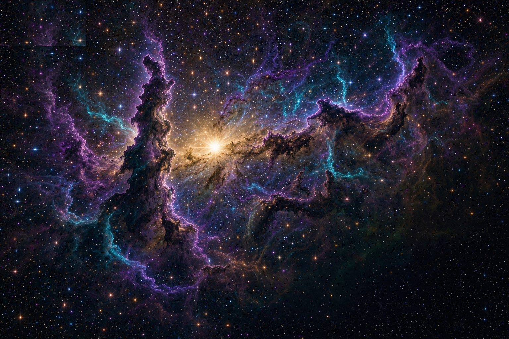

# 星空记忆海 · Starry Memory Ocean

把智能体的记忆渲染成一片可交互的宇宙星空：每条记忆是一颗发光星，沿**四旋臂银河**分布，重要性越高越靠近银心；同项目 / 共享标签的记忆连成星座。支持旋转、缩放、搜索、层级筛选、时间轴回放、点击看全文，还能记录新记忆让星图持续增长。

产出是**单文件、离线可开、零外部依赖**的 HTML —— 双击即看，断网照跑。

## 效果预览

打开 [`demo/starry-memory-ocean.html`](demo/starry-memory-ocean.html)（用本项目真实记忆生成的示例，内嵌星云背景，约 3.3MB）。



三层视觉叠加：AI 生成的壁纸级深空星云 → 2200 颗随视角旋转/闪烁的深空星场 → 四旋臂银河数据星。

## 这是什么

一个 [WorkBuddy](https://www.workbuddy.cn/) Skill，也可当作独立工具用（脚本是纯 Python 标准库，不依赖 WorkBuddy）。

## 目录结构

```
├── SKILL.md                      技能说明（触发条件 / 工作流 / 交互）
├── scripts/
│   ├── collect_memories.py       采集器：Markdown 记忆文件 → 结构化 JSON
│   ├── render.py                 渲染器：JSON + 星云背景 → 单文件 HTML
│   └── add_memory.py             写入器：新增一条记忆
├── assets/
│   ├── ocean-template.html       星图模板（视觉与交互全在此）
│   └── nebula-bg.png             AI 生成深空星云背景（已去水印）
├── references/
│   └── inspiration-gallery.md    8 个同类开源作品与二创借鉴点
└── demo/
    └── starry-memory-ocean.html  成品示例
```

## 快速使用

```bash
# 1. 采集记忆（--include-user 连用户级 SOUL/USER/MEMORY 一起纳入）
python scripts/collect_memories.py --workspace "<你的项目目录>" --include-user --out memories.json

# 2. 渲染星图
python scripts/render.py --data memories.json --out "星空记忆海.html"

# 3. （可选）记录一条新记忆，再重跑 1、2 让星图增长
python scripts/add_memory.py --text "一条新记忆" --layer fact --importance 4 --workspace "<你的项目目录>"
```

脚本用纯标准库，任何 Python 3 都能跑，无需 pip 安装。

## 设计来源

视觉与交互借鉴了以下社区作品，详见 [`references/inspiration-gallery.md`](references/inspiration-gallery.md)：STELLORA、human-memory「记忆宇宙」、dsh-meow-constellation 七层星图、UluP Life、memory-constellation、Phoenix Grove、Starlogue 等。

## 约定

- 单文件、离线、零 CDN 依赖 —— 现场演示不翻车的底线。
- 记忆数据全部本地处理，不上传任何服务。
- 背景图为一次性 AI 生成资产，后续渲染复用。

MIT License.
